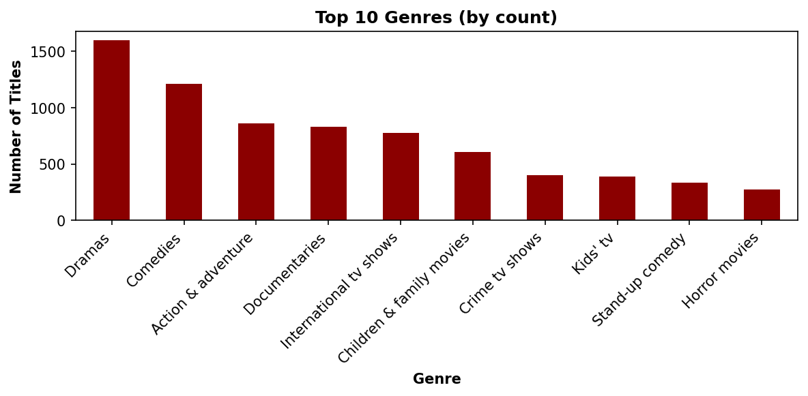

# Netflix Genre Classification

Predicting a Netflix title's primary genre from its title and description with a bag-of-words Multinomial Naive Bayes model.

Course project for MIS 515 (Programming Data-Driven Applications) at San Diego State University, Fall 2025. I built the data cleaning, exploratory analysis, model and evaluation; my teammate Yarely Virgen wrote the project report.

## Results

| Model | Test accuracy |
|---|---|
| Baseline: always predict the most common genre ("dramas") | 18.22% |
| Multinomial Naive Bayes on title + description | **42.05%** |

Test set: 4,402 held-out titles across 33 genres (50/50 split, `random_state=42`). The model handles the large genres well and almost never predicts the rare ones, which matches the class imbalance in the data.



## Data

[Netflix Movies and TV Shows](https://www.kaggle.com/datasets/shivamb/netflix-shows) on Kaggle: 8,807 titles. The notebook downloads it with `kagglehub`, or reads a local copy from `data/netflix_titles.csv`. The data is not stored in this repo.

## Approach

1. **Cleaning:** dropped rows missing a description or genre, removed duplicate title and description pairs, lowercased the text.
2. **Label:** primary genre = the first genre listed. Genres with a single title were dropped, leaving 33 classes and 8,803 titles.
3. **Exploration:** genre counts, release years and a genre word cloud, which showed strong class imbalance.
4. **Features:** `CountVectorizer` with the 7,000 most frequent tokens from title + description.
5. **Model:** Multinomial Naive Bayes, compared against a majority-class baseline.

## What I would try next

- TF-IDF features with logistic regression or a linear SVM
- Class weights or a stratified split to handle the imbalance
- Multi-label prediction, since most titles list several genres

## Run it

```
pip install -r requirements.txt
jupyter notebook netflix_genre_classification.ipynb
```

It also runs in Google Colab.

**Tools:** Python, pandas, scikit-learn, matplotlib, wordcloud
